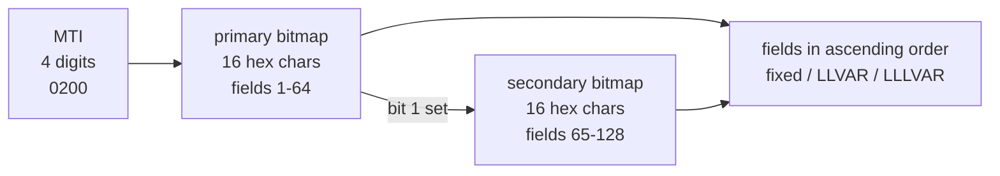

# iso8583-go

[](https://github.com/HelenArams/iso8583-go/actions/workflows/ci.yml)
[](https://pkg.go.dev/github.com/HelenArams/iso8583-go)

I wanted something small to poke at ISO 8583 messages without pulling in jPOS
or a big Go framework. Most of the time I just need to build an `0200`, see
what the bytes look like, throw it at a test host and read the answer back.
So this is that: a tiny packer/unpacker in plain Go, no dependencies outside
the standard library, plus a toy host and a client to play with.

It's an **educational subset** of ISO 8583:1987 with ASCII encoding. It is not
certified against any scheme and I wouldn't put it in front of real card
traffic. For learning the format and writing test tooling it works well.

## What a message looks like



For example, a purchase with PAN, processing code and amount:

```
0200 7000000000000000 16 4111111111111111 000000 000000001000
 MTI  bitmap (2,3,4)  LL  field 2          f3     f4
```

The secondary bitmap only shows up when some field above 64 is set, and bit 1
of the primary bitmap says so. You never set field 1 yourself.

## Using it

```sh
go get github.com/HelenArams/iso8583-go
```

```go
msg := iso8583.NewMessage("0200")
msg.Set(2, "4111111111111111")
msg.Set(3, "000000")
msg.Set(4, "1000")   // numeric fixed fields get zero-padded -> 000000001000
msg.Set(11, "000001")
msg.Set(41, "TERM0001")
msg.Set(49, "978")

data, err := iso8583.Pack(msg, spec87.Spec)
// 02007020000000808000164111111111111111000000000000001000000001TERM0001978

back, err := iso8583.Unpack(data, spec87.Spec)
fmt.Println(back)
// MTI 0200
//   002  411111******1111
//   003  000000
//   ...
```

`Message.String()` masks the PAN (field 2), track 2 (field 35) and the PIN
block (field 52), so printing a message into logs doesn't leak card data.

Errors from `Pack`/`Unpack` are `*iso8583.FieldError` with the field number and
byte offset, and wrap sentinels you can check with `errors.Is`:

```go
_, err := iso8583.Unpack([]byte("0200"+"2000000000000000"+"00000A"), spec87.Spec)
// iso8583: field 3 at offset 20: invalid character: 'A' at position 5 in Numeric field
errors.Is(err, iso8583.ErrInvalidChar) // true
```

### Field types

| Type           | ISO attr | Allowed chars              | Notes                                  |
|----------------|----------|----------------------------|----------------------------------------|
| `Numeric`      | n        | `0-9`                      | fixed ones are left-padded with `0`    |
| `Alpha`        | a        | letters, space             | fixed ones are right-padded with space |
| `Alphanumeric` | an / ans | printable ASCII            | right-padded with space                |
| `Binary`       | b        | hex digits                 | length counts bytes, wire is 2x hex    |
| `Track2`       | z        | `0-9`, `=`, `D`            | no padding                             |

Length can be `Fixed`, `LLVAR` (2-digit prefix, max 99) or `LLLVAR` (3-digit,
max 999).

### Bring your own spec

`spec87.Spec` covers the fields I hit most often: 2, 3, 4, 7, 11, 12, 13, 14,
22, 25, 32, 35, 37, 38, 39, 41, 42, 43, 49, 52, 54, 55, 70, 90 and 128. Every
real interface bends the standard somewhere, so clone it and change what you
need:

```go
spec := spec87.Clone()
spec[55] = iso8583.FieldSpec{Name: "ICC data", Type: iso8583.Alphanumeric, Length: 999, LenType: iso8583.LLLVAR}
spec[60] = iso8583.FieldSpec{Name: "Private use", Type: iso8583.Alphanumeric, Length: 999, LenType: iso8583.LLLVAR}
if err := spec.Validate(); err != nil {
    log.Fatal(err)
}
```

## Playing with the toy host

There are two small commands. `iso8583-echo` is a fake authorization host:
it answers `0100`/`0200` with `0110`/`0210`, field 39 = `00`, unless the amount
ends in `05`, then it declines with `05`. Handy for testing decline paths.
It also acks `0400` and `0800`. Framing is a 2-byte big-endian length prefix
(package `netio`).

```sh
go run ./cmd/iso8583-echo -addr :8583
```

In another terminal:

```sh
go run ./cmd/iso8583-send -amount 1000
# approved: response code 00, authorization code 000001

go run ./cmd/iso8583-send -amount 2505
# declined: response code 05      (exit status 2)
```

`iso8583-send -h` lists all flags. `-wire` dumps the raw bytes too (careful,
that one shows the full PAN).

## Layout

```
.             package iso8583: Message, Spec, Pack, Unpack, bitmap, errors
spec87/       ready-made 1987 spec
netio/        length-prefixed framing over net.Conn
cmd/
  iso8583-echo/   toy host
  iso8583-send/   client
```

## Tests

```sh
make test     # go test -race -cover ./...
make bench
make fuzz     # 60s of FuzzUnpack
make lint     # golangci-lint, installed into .tools/
```

There are golden pack/unpack tests for each field type, bitmap edge cases
(fields 1, 64, 65, 128), malformed input, a fuzz target for `Unpack` (it did
find a real bug: LL prefixes bigger than the spec max were getting through),
and loopback tests for the echo server.

## Not done (yet)

- [ ] BCD / EBCDIC encodings, everything is ASCII right now
- [ ] binary bitmaps (some hosts send 8 raw bytes instead of 16 hex chars)
- [ ] maybe TLV parsing for field 55, would be nice for EMV stuff

## License

MIT
